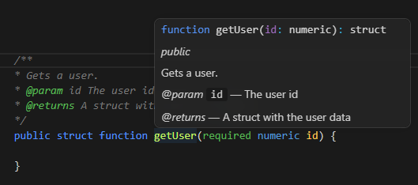
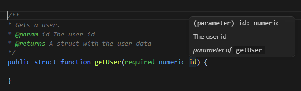
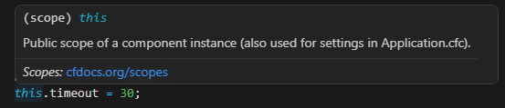
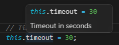
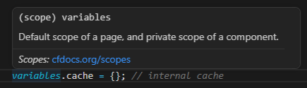
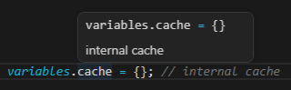
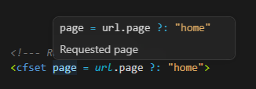
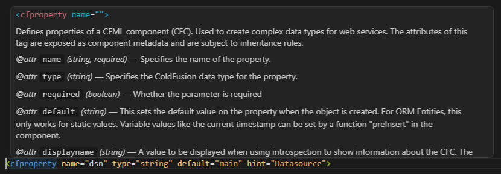
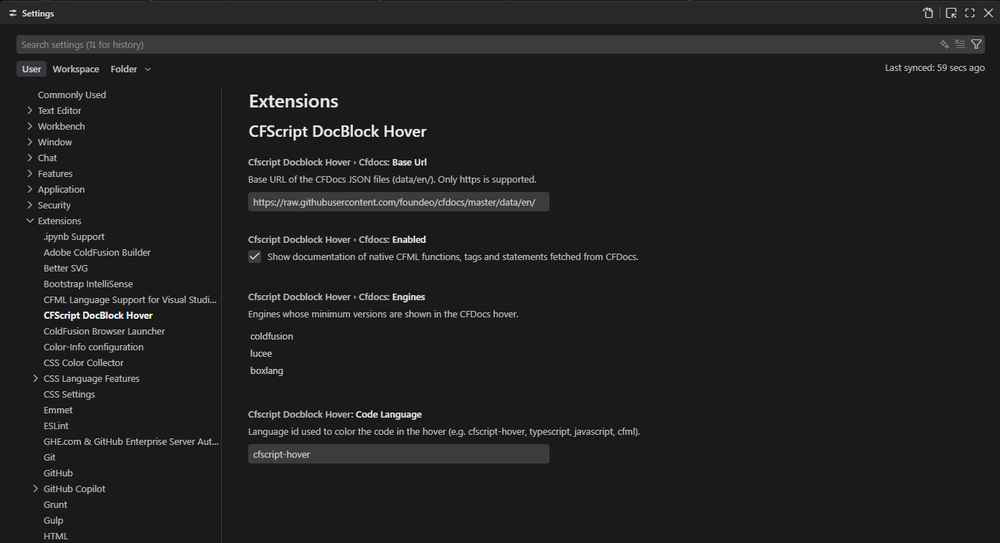

# ColdFusion CFScript DocBlock Hover

[](LICENSE)
[](https://github.com/framecodeinc/cf-cfscript-docblock-hover)
[](https://github.com/framecodeinc/cf-cfscript-docblock-hover/issues)
[](https://github.com/framecodeinc/cf-cfscript-docblock-hover/commits)


Shows the documentation of your CFML code in a hover tooltip, the way VS Code does for JavaScript: signature, description, parameters and return value. It works in `.cfc` components and in `.cfm` files, in both cfscript and tag syntax.

It also shows the documentation of native ColdFusion functions, tags and statements by querying [CFDocs](https://cfdocs.org) online. The CFDocs data is **not bundled** with the extension.

## What it documents

### Your own code

| Element | What it shows | Where it comes from |
|---|---|---|
| cfscript functions | TypeScript-style signature, description, `@param`, `@returns`, modifiers | `/** ... */` docblock above the function |
| `<cffunction>` and `<cfargument>` | Same as above | `<!--- ... --->` comment above, `hint` and `description` |
| Components (`new MyComponent()`, `extends="..."`) | `component Name extends Base`, description and constructor (`init`) signature | Docblock above `component`, or `hint`, or a comment above `<cfcomponent>` |
| Parameters (`id`, `arguments.id`) | `(parameter) id: numeric` and its description | Function signature and `@param` / `hint` |
| Local variables (`var x`, `local.x`, `for (var i ...)`, `<cfset var x>`) | `var x: type = value` | Comment above or at the end of the line |
| Scope fields (`variables.x`, `this.x`, `application.x`, `session.x`, `request.x`, `server.x`) | `scope.x = value` | Comment above or at the end of the line |
| Unscoped variables (`<cfset page = ...>`, `page = ...;`) | `page = value` | Comment above or at the end of the line |
| `property`, `<cfproperty>`, `<cfparam>` | Type, default value and `hint` | Attributes and comment above |
| Request scopes (`url.x`, `form.x`, `cookie.x`, `client.x`) | Type and value when declared with `cfparam` or assigned | Comment and attributes; otherwise generic text |

Base components (`extends`) are walked upwards: if a field or method is not in the current file, it is looked up in the parent, the grandparent, and so on.

### How to write the documentation

```cfml
/**
 * Gets a user.
 * @param id The user id
 * @returns A struct with the user data
 */
public struct function getUser(required numeric id) { ... }
```

Both `@param name description` and the ColdFusion style `@name description` are supported.




```cfml
// Timeout in seconds
this.timeout = 30;

variables.cache = {}; // internal cache
```








```cfml
<!--- Requested page --->
<cfset page = url.page ?: "home">

<cfproperty name="dsn" type="string" default="main" hint="Datasource">
```




## What is covered by CFDocs and what is not

The extension queries CFDocs only when the name is **not** a function or variable from your own code. Your code always takes priority.

| Element | Documented? | Source |
|---|---|---|
| Native functions (`arrayAppend(`, `structKeyExists(`...) | Yes: signature, description, parameters, return value, engines and link | CFDocs |
| Tags (`<cfhttp`) | Yes: syntax, description and attributes | CFDocs |
| Tag attributes (`method` in `<cfhttp method="get">`) | Yes: type, whether it is required, description and allowed values | CFDocs |
| Tags written in cfscript (`cfcontent(type="...")`, `cfcontent type="...";`) and their attributes | Yes, with the cfscript syntax | CFDocs |
| cfscript statements equivalent to a tag | Yes, with the documentation of the equivalent tag | CFDocs (see the list below) |
| `Application.cfc` settings (`this.name`, `this.sessionTimeout`...) | Yes, if they are `cfapplication` attributes | CFDocs |
| `Application.cfc` settings that are not in `cfapplication` (`this.mappings`, `this.datasource`...) | Yes, with a short description | Extension's own table |
| Native scopes (`url`, `form`, `cgi`, `cookie`, `client`, `session`...) | Yes, short description of the scope | Extension's own texts |
| CGI variables (`cgi.http_host`, `cgi.remote_addr`...) | Yes, for the most common ones | Extension's own table |
| Individual `url.` and `form.` variables | Generic text only, because they depend on each request | Not in CFDocs |
| Java methods (`getPageContext().getResponse().setStatus(404)`) | No | CFDocs does not document Java |
| Object methods and member functions (`myArray.append()`) | Not queried | — |
| Control keywords (`if`, `for`, `return`, `try`, `catch`...) | No | — |

**cfscript statements resolved with the equivalent tag:** `include` → `cfinclude`, `abort` → `cfabort`, `exit` → `cfexit`, `location` → `cflocation`, `lock` → `cflock`, `param` → `cfparam`, `savecontent` → `cfsavecontent`, `thread` → `cfthread`, `throw` → `cfthrow`, `rethrow` → `cfrethrow`, `transaction` → `cftransaction`, `import` → `cfimport`.

If CFDocs has no entry for the name, or there is no connection, nothing from CFDocs is shown.

### How CFDocs is queried

- Only the file of the element under the cursor is requested, for example `https://raw.githubusercontent.com/foundeo/cfdocs/master/data/en/arrayappend.json`.
- Only the name of the function or tag is sent, never your code.
- Responses are cached on your machine for 7 days. If a name does not exist in CFDocs, that is remembered for 1 day. If there is no connection, the extension does not retry for 1 minute.
- The first query for each element needs internet access.

## Settings

You can configure the extension in two ways.

**From the Settings UI**

1. Open Settings (`Ctrl+,` on Windows/Linux, `Cmd+,` on macOS).
2. Search for `CFScript DocBlock Hover` (or `cfscriptDocblockHover`).
3. Change the values. They are saved automatically.



**From `settings.json`**

1. Open the Command Palette (`Ctrl+Shift+P`) and run `Preferences: Open User Settings (JSON)`. To apply the settings only to the current project, run `Preferences: Open Workspace Settings (JSON)` instead.
2. Add the keys you want to change, for example:

```json
{
  "cfscriptDocblockHover.codeLanguage": "typescript",
  "cfscriptDocblockHover.cfdocs.engines": ["coldfusion"]
}
```

User settings apply to every project. Workspace settings apply only to the open project and take priority over user settings.

| Setting | Default | Description |
|---|---|---|
| `cfscriptDocblockHover.codeLanguage` | `cfscript-hover` | Language used to color the code in the hover. You can use `typescript`, `javascript` or `cfml` if you have a CFML grammar installed. |
| `cfscriptDocblockHover.cfdocs.enabled` | `true` | Shows native documentation by querying CFDocs. |
| `cfscriptDocblockHover.cfdocs.baseUrl` | `https://raw.githubusercontent.com/foundeo/cfdocs/master/data/en/` | Base URL of the CFDocs JSON files. Only `https` is supported. |
| `cfscriptDocblockHover.cfdocs.engines` | `["coldfusion", "lucee", "boxlang"]` | Engines whose minimum versions are shown. With `["coldfusion"]` you only see ColdFusion. |

Changes apply immediately, without reloading the window. Responses already cached from CFDocs are kept for up to 7 days, even if you change `baseUrl`.

The hover colors follow your current theme. If the code in the hover appears without color, change `codeLanguage` to `typescript`.

## Limitations

**General**
- It uses regular expressions, not a real parser. It can fail with very unusual signatures, for example parentheses inside default values.
- In cfscript functions it only reads `/** */` docblocks.

**Variables**
- If an assignment spans several lines, only the first line is shown.
- Unscoped assignments in cfscript are only detected when the line ends with `;`, and the hover appears on any word with that name, even in plain HTML text.
- Declarations that do not start the line with `var` are not detected (for example `if (x) var y = 1;`).
- `application.`, `session.`, `request.` and `server.` in other files are searched only in the `.cfc` files of the workspace, and only if the variable has a comment.

**Components and inheritance**
- Base components are searched only in the `.cfc` files of the open workspace, not in mappings that point to other folders.
- `createObject("component", "path.Component")` is not resolved.
- Functions defined with `<cffunction>` are recognized, but a `<cfcomponent>` only provides `extends` and the description.

**Tags**
- `<cfset>`, `<cfparam>` and `<cfproperty>` are detected only if the tag starts at the beginning of the line and is complete on a single line.
- `<cfinvoke>` and `<cfobject>` are not covered.

**CFDocs**
- Only the `cfinclude` entry has been checked against CFDocs. For the other statements in the list, the tag name is assumed to exist; if it does not, nothing is shown.
- `Application.cfc` settings depend on `cfapplication` including them as attributes in CFDocs.

## Credits and licenses

The documentation of native functions and tags comes from [CFDocs](https://cfdocs.org), a community project maintained by Foundeo, under the MIT license (© 2013 Foundeo Inc). According to its license file, the initial CFDocs documentation was generated from content of the CFEclipse project, also under the MIT license (© 2004 Rob Rohan).

The extension does not include or redistribute that data: it queries it online while you work. If it were ever bundled inside the extension, the copyright notice and the text of both licenses would need to be included.

This extension is not affiliated with Adobe, Lucee, Ortus Solutions or Foundeo.

## Author

FrameCode Inc.